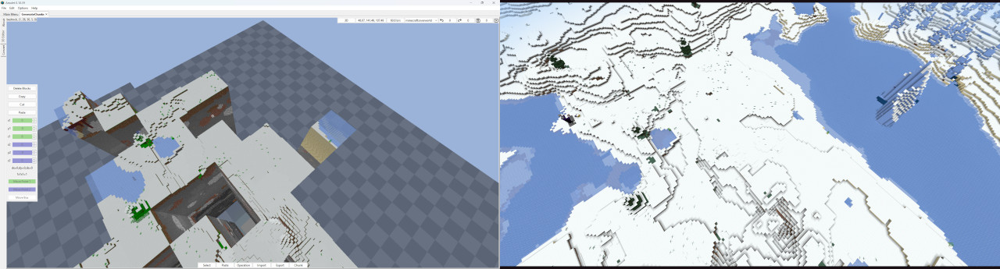
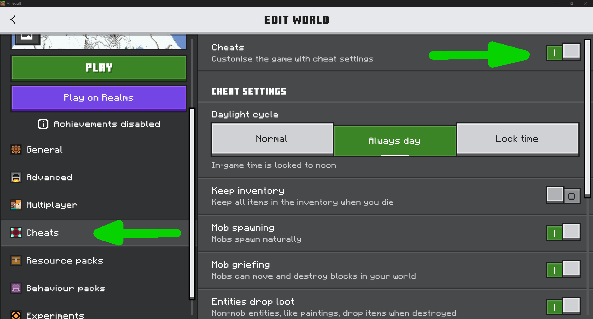
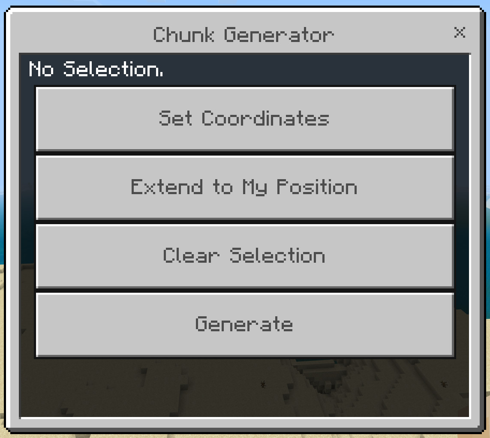
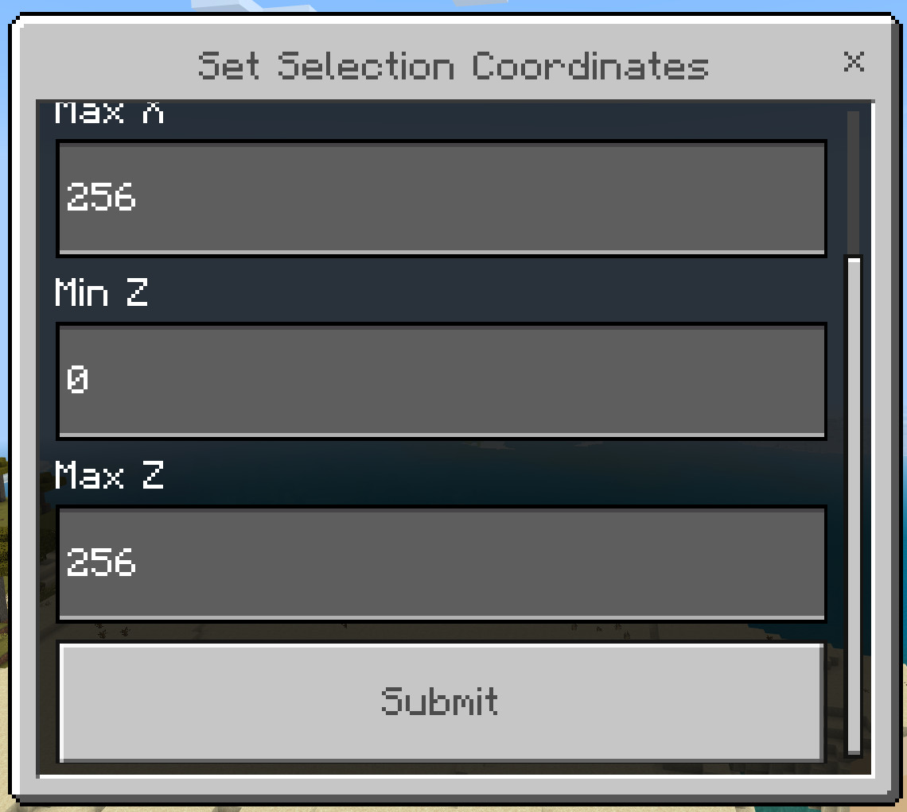

# Chunk Generator Addon

This is a Minecraft Bedrock addon to force the game to generate and save terrain in a selection.

## Why does this exist?

External world editors, such as Amulet Editor, can only display and edit terrain that has been written to the world save.
This confuses some users when they see holes in the terrain in the external editor.
Minecraft Bedrock edition is particularly bad because it only saves terrain that has changed to minimise the size of the world save.

To force the game to save a chunk, it must be modified in some way. This can be done by placing a block in the chunk.
This can either be done manually by the user for each chunk they want to save, or automatically by this addon.

## How do I install the addon?

1) Download the addon by [clicking here](https://raw.githubusercontent.com/Amulet-Team/Chunk-Generator-Addon/main/ChunkGenerator.mcpack)
2) Double-click the downloaded file to open it in Minecraft Bedrock Edition.
3) Open the worlds list in Minecraft Bedrock Edition
4) Click the pencil icon on the world you want to generate terrain in (or click create a new world)

5) Enable cheats for the world by clicking the cheats tab on the left and enabling the cheats toggle

6) Enable the addon for the world by clicking the behaviour packs tab on the left and activating the addon

7) Open or create the world

## How do I use the addon?

The addon adds a user interface and commands to start and stop the chunk generation process.

### User Interface

The user interface can be opened by typing `/chunk_generator:gui` in the chat:

Click on `Set Coordinates` and type in the minimum and maximum coordinates of the rectangle you want to generate.
Scroll down and click `Submit` to confirm the selection.

Alternatively, you can travel to the bounds of the area you want to generate and click `Extend to My Position` at each edge.
The selection will expand to include your current position.

If you make a mistake you can click `Clear Selection` to delete the selection.

Once you are happy with the selection, double-check the coordinates and the number of chunks that will be generated.

Click `Generate`.
The addon will make a small modification to each chunk to force the game to save it.
The progress will be logged in the chat.

If you want to stop the generation process, you can type `/chunk_generator:gui` in the chat to open the GUI again and click `Cancel`
or just type `/chunk_generator:stop` in the chat.

### Commands

`/chunk_generator:generate <min_x: int> <min_z: int> <max_x: int> <max_z: int>` will start the game generating chunks that intersect the rectangle defined by the minimum and maximum coordinates.

`/chunk_generator:stop` will stop the chunk generation process.

## After Generation

## How long does it take to generate chunks?

My computer was able to generate 4096 chunks (1024x1024 blocks) in under 25 seconds.
This is much faster than other chunk generators I have seen.
Note: Your computer is probably slower than mine, so don't expect to get the same speed.
