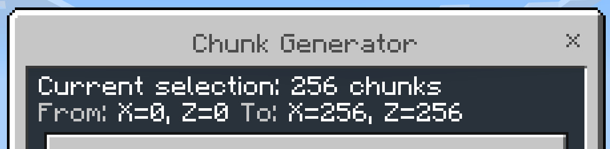
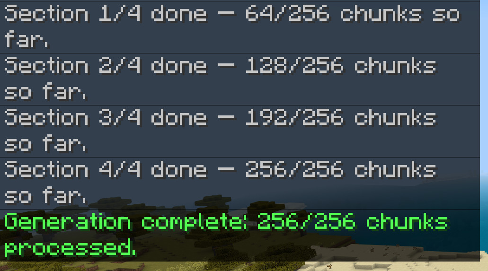
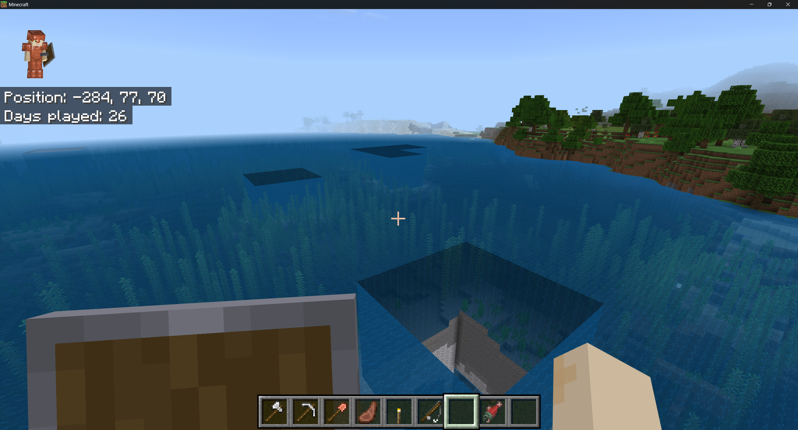

# Chunk Generator - aceinetx

This is a Minecraft Bedrock addon to force the game to generate and save terrain in a selection.

Fork maintained at [Olrik-WP/Chunk-Generator-Addon](https://github.com/Olrik-WP/Chunk-Generator-Addon), based on Amulet Team's addon and aceinetx's remote-generation changes. Pack version **1.0.1**; original UUIDs and stable dependencies (`@minecraft/server` 2.8.0, `@minecraft/server-ui` 2.1.0) are preserved.

## BDS safety changes

Target environment: **Bedrock Dedicated Server 1.26.66.1, stable APIs, Beta APIs disabled**. Automated checks pass; the changes still require validation on a real BDS instance.

- Player teleports **before** remote ticking-area creation and **8 × 8 chunk sections** are preserved. The addon never switches the player to Spectator or Creative.
- Resistance V and Slow Falling are applied and verified before the first movement. Effects added by the addon are renewed during processing. Every teleport uses `keepVelocity: false`.
- Temporary destinations retain the previous X/Z coordinates and use `dimension.heightRange.max + 4` to stay above the block volume. This height complements the protections and watchdog; it is not sufficient protection by itself. BDS must confirm that these destinations are accepted and still unblock remote generation.
- A watchdog checks every tick for dangerous descent, dimension changes, insufficient protection, obstructed or liquid-filled body space, and unavailable blocks. It interrupts processing and attempts an immediate return. Each load has a 600-tick timeout; creations that finish after cancellation remain tracked for cleanup.
- The exact original position, dimension and rotation are restored and verified. A small ticking area keeps the return location loaded. Start while standing on a supported full block with clear air around the player; unknown supports, slabs and obstructed locations are refused.
- Only one generation can run at a time. Unfinished recovery prevents a new start. `/chunk_generator:stop` cancels the player's generation or retries recovery.
- Area removal, return, effect cleanup and generation-state reset are independent. A world recovery journal, `chunk_generator:recovery`, is written before effect application and movement and retained until recovery is complete. Recovery is retried after reconnecting and periodically while the addon runs.
- If the original landing becomes unsafe, the addon retains the journal and protections and attempts an emergency relocation above the original location. Clear the original landing and retry recovery to complete the exact return.

### Existing effects

Preexisting Resistance and Slow Falling effects are **left untouched**: their strength, particle settings and naturally remaining duration are preserved. Stable APIs expose strength and duration, but not every display setting, so replacing and recreating an existing effect would not restore it exactly. If an existing effect is too weak or expires within 100 ticks, generation is refused or interrupted before expiration. Existing effects are neither extended nor revived after expiration. See the [Effect reference](https://learn.microsoft.com/en-us/minecraft/creator/scriptapi/minecraft/server/effect?view=minecraft-bedrock-stable) and [application options](https://learn.microsoft.com/en-us/minecraft/creator/scriptapi/minecraft/server/entityeffectoptions?view=minecraft-bedrock-stable).

The addon's own protections are removed after a verified return and a landing tick. External changes with a different strength or a clearly different duration are preserved. The API does not identify an effect's source: an identical effect reapplied by another addon may be indistinguishable. Inventory, unrelated effects, game rules and game mode are not changed.

### World integrity and limitations

Only verified `minecraft:air` is temporarily replaced and immediately restored, with no asynchronous wait between writes. Normal chunks use the first read near the top of the dimension. Under a solid ceiling, four columns are searched with watchdog pauses. Containers, solid blocks and custom blocks are never replaced. A chunk fails if no safe air location is found in those sampled columns. The temporary location is journaled before modification to support repair after an interruption.

Counters distinguish successful, partial, failed, canceled and unstarted sections. Chunks count as processed only after verifying both the temporary write and restoration. **Processed does not mean confirmed saved to disk.** Logs report section progress and actionable errors instead of repetitive `x:` / `z:` messages.

Resistance V does not protect against void damage. These measures do not guarantee absolute invulnerability or immediate recovery after a server crash. Player data and script properties are not an atomic disk transaction; a crash may prevent the latest journal write from being saved. Player return and effect recovery require the addon to be running and the player to be online. The original game mode is recorded, but the addon never changes it, including when another addon changes it externally.

## Building and automated checks

From the repository root in PowerShell:

```powershell
.\generate.ps1
npm test
```

The builder produces `ChunkGenerator-aceinetx-v1.0.1.mcpack` from `src/` without rewriting the source manifest. It validates the name, versions, UUIDs, dependencies, four commands and every archived file. Entry order and timestamps are fixed, making repeated builds reproducible with the same PowerShell/.NET environment. Compression can differ between .NET environments. Tests use Node.js 22 and its built-in tools; no dependency installation is required. Development files and tests are excluded from the pack.

Automated tests run the actual controller against a simulated API: 360 chunks in nine sections, teleport-before-load ordering, capacity/creation/removal errors, unloaded chunks, cancellation during and between sections, late creations, disconnects, simulated restarts, concurrent requests, effect preservation and renewal, ineffective returns, block restoration and container preservation. Commands and GUI buttons are also checked. These tests do not simulate Minecraft physics or LevelDB and do not prove real terrain generation or persistence.

## Required validation on a real BDS server

Use world copies with **BDS 1.26.66.1**, Survival and Beta APIs disabled. Compare identical starting worlds using the reference pack and the corrected pack. The local pre-correction pack is preserved at `artifacts/baseline/ChunkGenerator-aceinetx-v1.0.1-before-safety.mcpack` when created during the audit; this directory is excluded from Git and packaging.

1. Repeat `/chunk_generator:generate -290 -376 -24 -70`: expect **360/360 chunks and nine successful sections**. Verify remote movement and compare processing times. Repeat on previously ungenerated terrain, checking that the dimension-aware height does not reintroduce the original loading stall.
2. Verify protection before movement, renewal during a long run, fall damage and return velocity. Check health, inventory, Survival mode, position, dimension, rotation and effects afterward. Test sufficient, weak and nearly expired preexisting effects.
3. Test the Overworld, the Nether with a solid ceiling, and the End over void; include high terrain, tall builds, lava and an obstructed return location. Check safety interruptions, exact-return recovery, remaining barriers and container contents.
4. Cancel during loading and between sections; disconnect and reconnect; request generation twice from one player and from two different players. Check return, effects, state and Script API ticking-area cleanup. `/tickingarea list` alone does not inspect these API-managed areas, which are separate from command-created areas.
5. Test a clean shutdown during processing and recovery after restart. Test an abrupt interruption only on a disposable world copy, without assuming that the latest journal write survived.
6. After processing, allow a world save, stop BDS cleanly, restart it and check the terrain. Stop BDS again and inspect a copy of the save with Mapelix. Confirm all **360 expected chunks remain after restart**, rather than relying solely on the script's counter.

Engine failures are injected in automated tests; real ticking-area limits, loading times and engine behavior must also be observed on BDS. Real-server validation of these corrections has not been performed here.

## Why does this exist?

External world editors, such as Amulet Editor, can only display and edit terrain that has been written to the world save.
This confuses some users when they see holes in the terrain in the external editor.
Minecraft Bedrock edition is particularly bad because it only saves terrain that has changed to minimise the size of the world save.

To force the game to save a chunk, it must be modified in some way. This can be done by placing a block in the chunk.
This can either be done manually by the user for each chunk they want to save, or automatically by this addon.


## How do I install the addon?

1) Download the fork's addon by [clicking here](https://raw.githubusercontent.com/Olrik-WP/Chunk-Generator-Addon/main/ChunkGenerator-aceinetx-v1.0.1.mcpack)
2) Double-click the downloaded file to open it in Minecraft Bedrock Edition.
3) Open the worlds list in Minecraft Bedrock Edition
4) Click the pencil icon on the world you want to generate terrain in (or click `Create new world`)


5) Enable cheats for the world by clicking the cheats tab on the left and enabling the cheats toggle


6) Enable the addon for the world by clicking the behaviour packs tab on the left and activating the addon


7) Open or create the world

## How do I use the addon?

The addon adds a user interface and commands to start and stop the chunk generation process.

### User Interface

The user interface can be opened by typing `/chunk_generator:gui` in the chat:


Click on `Set Coordinates` and type in the minimum and maximum coordinates of the rectangle you want to generate.
Scroll down and click `Submit` to confirm the selection.


Alternatively, you can travel to the bounds of the area you want to generate and click `Extend to My Position` at each edge.
The selection will expand to include your current position.

If you make a mistake, you can click `Clear Selection` to delete the selection.

Once you are happy with the selection, double-check the coordinates and the number of chunks that will be generated to make sure they look correct.



Click `Generate`.
The addon will make a small modification to each chunk to force the game to save it.
The progress will be logged in the chat.



If you want to stop the generation process, you can type `/chunk_generator:gui` in the chat to open the GUI again and click `Cancel`
or just type `/chunk_generator:stop` in the chat.

### Commands

`/chunk_generator:generate <min_x: int> <min_z: int> <max_x: int> <max_z: int>` will start the game generating chunks that intersect the rectangle defined by the minimum and maximum coordinates.

`/chunk_generator:stop` will stop the chunk generation process.

`/chunk_generator:radius <radius: int>` sets a square selection centered on the player. The historical convention is preserved: the argument is the square's side length in blocks. It must be a positive whole number.

## After Generation


## Some chunks are missing in game. How do I fix this?



We call these void chunks. They are chunks that exist but only contain air.
They are most commonly created in Amulet by modifying a chunk that does not exist.
Amulet will populate the chunk with air so that it has something to apply the changes to.
This addon can only create terrain when the chunk does not exist.

If you want to generate terrain in these chunks, you will first need to delete the whole chunk
(eg in Amulet's chunk tool) then generate the terrain using this addon.

## How long does it take to generate chunks?

The following is the original upstream benchmark; it has not been remeasured for this fork's safety changes.

My computer was able to generate 4096 chunks (1024x1024 blocks) in under 25 seconds.
This is much faster than other chunk generators I have seen.

Note: Your computer is probably slower than mine, so don't expect to get the same speed.
