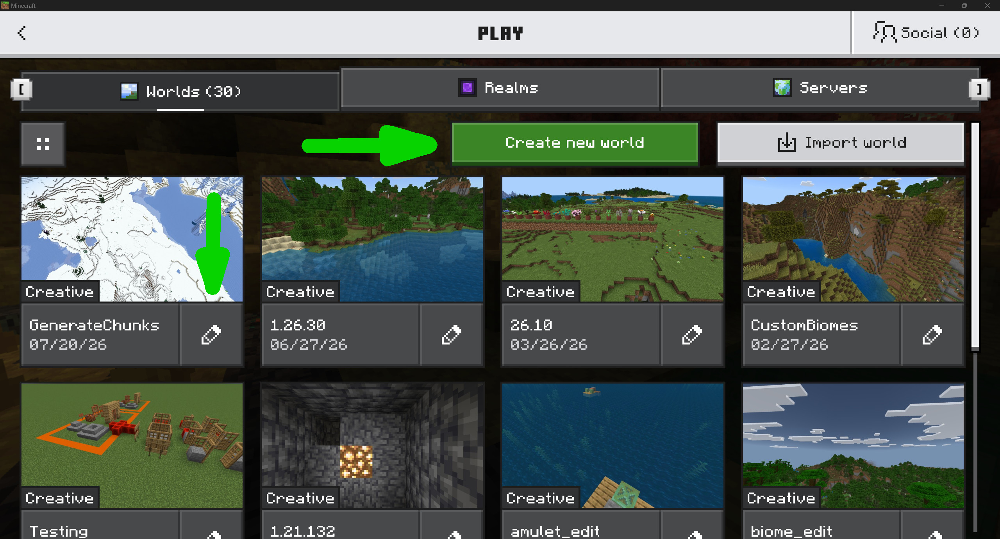
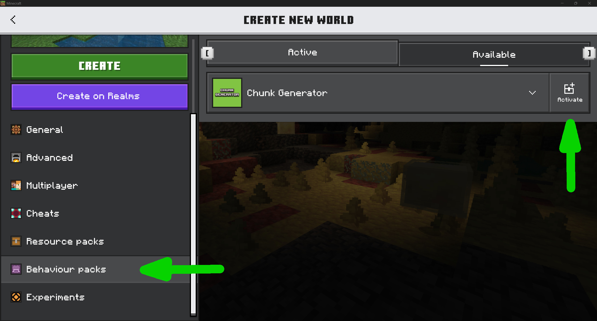
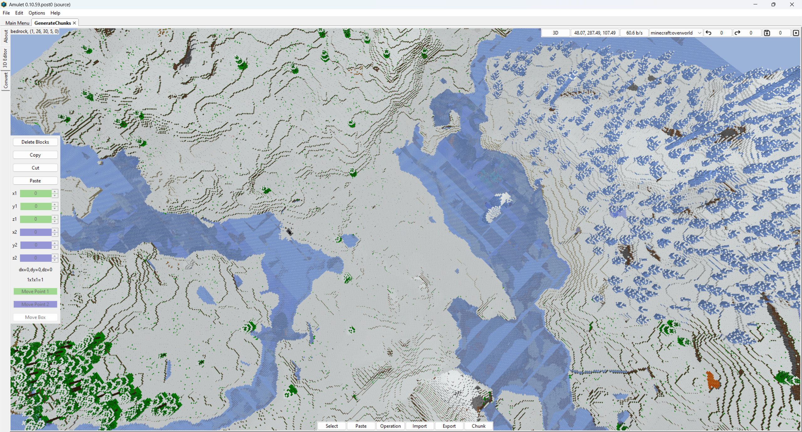

# Chunk Generator - aceinetx

Generate and save terrain within a selected area in Minecraft Bedrock.

This fork is based on [aceinetx/Chunk-Generator-Addon](https://github.com/aceinetx/Chunk-Generator-Addon), which builds on the original [Amulet-Team/Chunk-Generator-Addon](https://github.com/Amulet-Team/Chunk-Generator-Addon). The original addon documentation is retained below.

**Version: 1.0.5** · [Download the pack](https://raw.githubusercontent.com/Olrik-WP/Chunk-Generator-Addon/main/ChunkGenerator-aceinetx-v1.0.5.mcpack)

## Changes in this fork

- Safer Survival teleports with temporary Resistance V, Slow Falling, velocity reset and a monitored aerial anchor. The player stays above terrain while sections load; recoverable drift is corrected without canceling generation.
- Verified return to the original position and dimension, while preserving existing effects. Initial orientation is restored best-effort; mouse movement or engine angle normalization does not cancel a valid teleport.
- Indoor-friendly starting checks using Minecraft's actual ground support and collision bounds, including fractional standing heights. Return support is recorded and rechecked; refusal messages identify the cause, block and coordinates.
- Independent cleanup and persistent recovery after errors, cancellation or disconnection. Once the player is recovered and an abandoned area is confirmed removed, its lingering native request is tracked persistently in the background without blocking new generations or moving the player again.
- A global lock to prevent simultaneous generations.
- Air-only temporary block modifications, with restoration and recovery tracking to protect terrain and containers.
- Accurate chunk and section counters, precise watchdog diagnostics with phase/position/velocity, explicit pending-cleanup tasks and fewer repetitive logs. World saves remain managed by BDS.
- Blocking messages explain what the player must do: wait, cancel/retry, reconnect the affected player, restore the original landing, or contact the administrator. Non-blocking background cleanup is clearly identified.
- A reproducible PowerShell builder for the versioned `.mcpack`.

The inherited player teleports, ticking-area loading, 8 × 8 sections, GUI and four commands are retained. The player stays in Survival; original pack UUIDs and stable API dependencies are preserved. Recovery remains subject to the server running and its saved state.

## Build

Run from the repository root in PowerShell:

```powershell
.\generate.ps1
```

Output: `ChunkGenerator-aceinetx-v1.0.5.mcpack`.

Repository workflow and constraints are documented in [AGENTS.md](AGENTS.md).

## Original addon documentation

## Why does this exist?

External world editors, such as Amulet Editor, can only display and edit terrain that has been written to the world save.
This confuses some users when they see holes in the terrain in the external editor.
Minecraft Bedrock edition is particularly bad because it only saves terrain that has changed to minimise the size of the world save.

To force the game to save a chunk, it must be modified in some way. This can be done by placing a block in the chunk.
This can either be done manually by the user for each chunk they want to save, or automatically by this addon.


## How do I install the addon?

1) Download the fork's addon by [clicking here](https://raw.githubusercontent.com/Olrik-WP/Chunk-Generator-Addon/main/ChunkGenerator-aceinetx-v1.0.5.mcpack)
2) Double-click the downloaded file to open it in Minecraft Bedrock Edition.
3) Open the worlds list in Minecraft Bedrock Edition
4) Click the pencil icon on the world you want to generate terrain in (or click `Create new world`)



5) Enable cheats for the world by clicking the cheats tab on the left and enabling the cheats toggle


6) Enable the addon for the world by clicking the behaviour packs tab on the left and activating the addon



7) Open or create the world

## How do I use the addon?

The addon adds a user interface and commands to start and stop the chunk generation process.

### User Interface

The user interface can be opened by typing `/chunk_generator:gui` in the chat:


Click on `Set Coordinates` and type in the minimum and maximum coordinates of the rectangle you want to generate.
Scroll down and click `Submit` to confirm the selection.


Alternatively, you can travel to the bounds of the area you want to generate and click `Extend to My Position` at each edge.
The selection will expand to include your current position.

If you make a mistake, you can click `Clear Selection` to delete the selection.

Once you are happy with the selection, double-check the coordinates and the number of chunks that will be generated to make sure they look correct.


Click `Generate`.
The addon will make a small modification to each chunk to force the game to save it.
The progress will be logged in the chat.


If you want to stop the generation process, you can type `/chunk_generator:gui` in the chat to open the GUI again and click `Cancel`
or just type `/chunk_generator:stop` in the chat.

### Commands

`/chunk_generator:generate <min_x: int> <min_z: int> <max_x: int> <max_z: int>` will start the game generating chunks that intersect the rectangle defined by the minimum and maximum coordinates.

`/chunk_generator:stop` will stop the chunk generation process.

`/chunk_generator:radius <radius: int>` sets a square selection centered on the player. The historical convention is preserved: the argument is the square's side length in blocks. It must be a positive whole number.

## After Generation



## Some chunks are missing in game. How do I fix this?


We call these void chunks. They are chunks that exist but only contain air.
They are most commonly created in Amulet by modifying a chunk that does not exist.
Amulet will populate the chunk with air so that it has something to apply the changes to.
This addon can only create terrain when the chunk does not exist.

If you want to generate terrain in these chunks, you will first need to delete the whole chunk
(eg in Amulet's chunk tool) then generate the terrain using this addon.

## How long does it take to generate chunks?

The following is the original upstream benchmark; it has not been remeasured for this fork's safety changes.

My computer was able to generate 4096 chunks (1024x1024 blocks) in under 25 seconds.
This is much faster than other chunk generators I have seen.

Note: Your computer is probably slower than mine, so don't expect to get the same speed.
